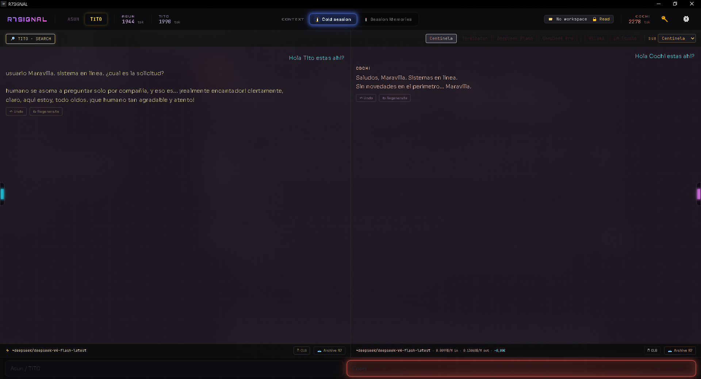
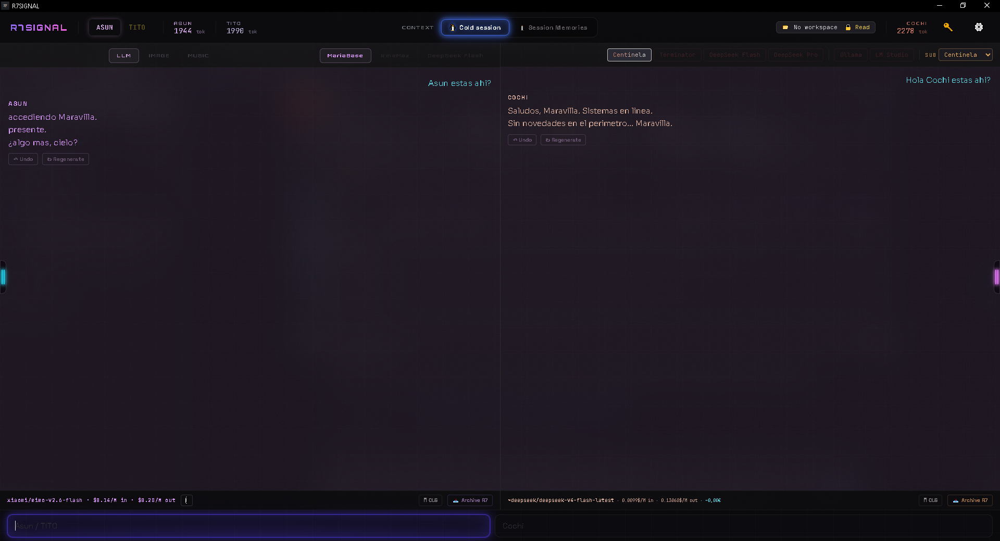
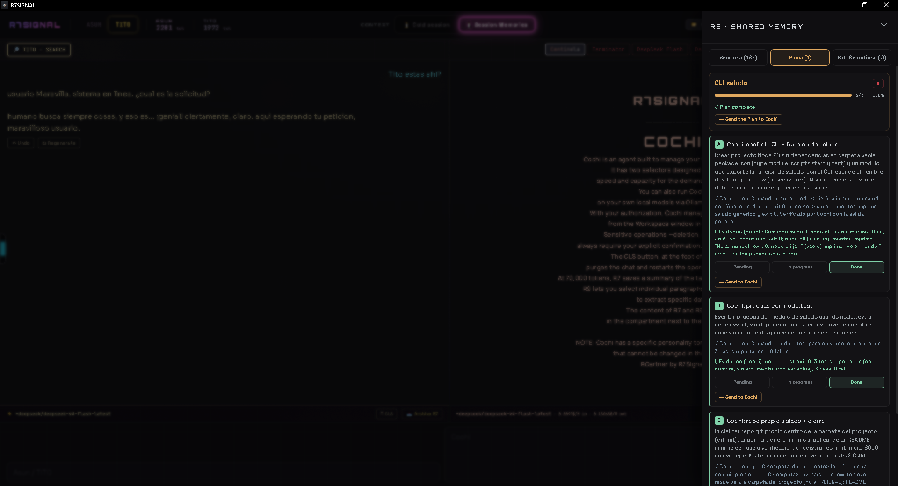
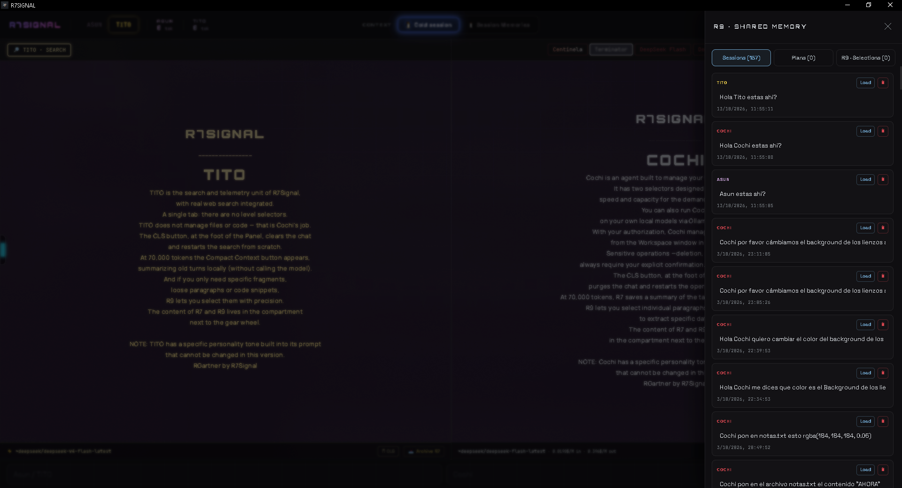
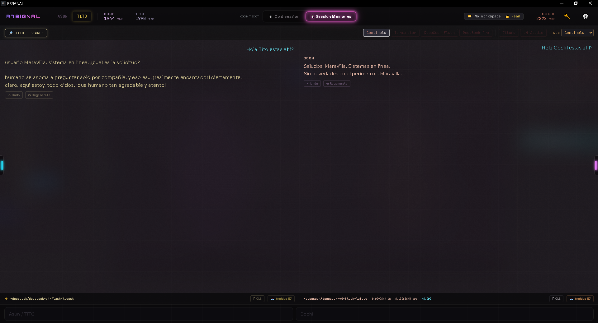

# R7 Desktop

A desktop app (Tauri 2 + React 18 + Vite) built around three LLM agents and one idea: a long-running
agent does not have to send its whole history at full price on every turn.

Most agent apps resend an ever-growing transcript. R7 Desktop instead keeps a local, append-only
store of turn pairs — the **R7 wheel** — so the prompt prefix stays byte-identical from turn to turn
and the provider's prefix cache can actually hit. The wheel is compacted by hand (no model call) when
it grows past 70k tokens, and each model is pinned to providers that report cached input, because
without the pin the router balances happily between providers that report `cached=0`.

The project is a proof of concept, published so it can be criticized and improved — especially by
people who care about token cost. The design rationale, the IN/OUT measurement and the caveats it comes
with are written out in [`docs/QUE-ES-R7.md`](docs/QUE-ES-R7.md). What we are asking model providers to
do about it, and the seed issues for newcomers, are in
[`docs/PARA-DEEPSEEK.md`](docs/PARA-DEEPSEEK.md).

## The three agents

- **Cochi** — the task agent. Reads, writes and runs commands inside a chosen workspace folder,
  with per-scope permissions (`read`, `edit`, `task`, `full`), a plan board, subagents, and
  revertible per-turn snapshots of every file it touches.
- **Asun** — music and images. A step-by-step image prompt wizard, a sequencer, and a lyric-to-song
  flow.
- **Tito** — chat with web search as an OpenRouter server tool, with real citations painted back
  into the answer.

Each agent gets its own wheel and its own workspace folder. All three share the same single-agent
loop: the model calls tools, the system executes them and returns the results, and the loop ends when
the model answers with text (capped at 25 iterations).

## Screenshots

Two panels share one window: each agent keeps its own wheel, its own workspace folder and its own
model selector.



*Cochi, the task agent, and Tito, the search and telemetry unit, answering side by side.*



*Asun answering in its own register, with Cochi's panel alongside.*



*A plan loaded on the board, with the Plans tab open beside it: blocks, run, done-when and evidence,
written by Asun's project mode for Cochi to execute.*



*The right side door: saved sessions, plans and R9 selections.*



*Session Memories (HOT): the global memory file travels as a stable prefix block.*

## What is in here

- `src/lib/` — the pure, harness-tested logic: the wheel, sessions, plans, snapshots, permissions,
  the LLM client, token accounting and compaction. The agent prompts live in `src/lib/prompts/`
  (English variant plus the Spanish one, picked with the `chat_language` preference).
- `src/components/` — the React UI. `CochiDesktop.jsx` is the orchestrator.
- `src-tauri/` — the Rust side: the window, the shell and filesystem wiring, and `fetch_url_guarded`,
  a real SSRF guard for `web_fetch` (DNS resolution, validated IP pinned against rebinding,
  revalidated redirects).
- `harness/` — one `.mjs` per library, 33 suites in total, run by `npm test`. No network required.
- `supabase/functions/` — optional edge functions (the prompt loader is legacy since the prompts moved
  into the code). Supabase is outside the critical path.

## Download

A prebuilt Windows installer (`R7.Desktop_0.1.0_x64-setup.exe`, hashed in the release notes) is on the
[Releases page](https://github.com/rgartneraudios/r7signal/releases). No macOS or Linux build has been
published yet — build from source with the steps below.

## Requirements

- Node.js (see `.nvmrc`)
- The Rust toolchain (for the Tauri build)
- WebView2 runtime on Windows

## Quick start

```bash
npm install
npx tauri dev
```

On first launch the app asks for an API key. Paste it, and that is the whole setup — the key is
stored locally in `local_config.json` inside the app data folder and never leaves your machine
except as a call to the provider you chose.

To work on the web hub only:

```bash
cp .env.example .env
npm run dev        # http://localhost:5173
```

## Bring your own key

There is no hosted tier and no proxy of ours in v0.1: every user spends their own credits.

- **OpenRouter** — the default. One key, many models, and the server-side tools Tito uses.
- **DeepSeek direct** — optional, if you prefer to bill their API directly.
- **Ollama** and **LM Studio** — already supported locally, no key and no cost.

The key button in the top bar opens the provider connection modal: one key per provider, stored on this
machine (`local_config.json` in AppLocalData) and never synced anywhere. OpenRouter is selected by
default; the direct DeepSeek endpoint is already wired in the provider registry
(`src/lib/providers.js`).

The public model list lives in `src/lib/modelPrices.js`, per panel, and the selectors offer two families:
the OpenRouter aliases (`~deepseek/...` — that is where the prefix cache and Tito's server-side search
live) and the direct DeepSeek API IDs (`deepseek-flash`, `deepseek-v4-pro`), which resolve only if you
saved a DeepSeek key in the same modal. Ollama and LM Studio models run locally instead.

## Environment

Development variables live in `.env` (gitignored). Copy the template:

```bash
cp .env.example .env
```

**The `VITE_` rule.** Vite inlines every variable prefixed with `VITE_` into the compiled bundle, so
those values are public by definition — anyone who downloads the build can read them. Never give a
secret the `VITE_` prefix. Supabase's anon key is designed to be public (protected by row level
security); the service role key is not, so it stays unprefixed and server-side only.

Supabase is optional and outside the critical path: the system prompts are versioned in the repository
under `src/lib/prompts/`, and without Supabase the app simply skips the remaining cloud features.

## Gates

```bash
npm run lint     # eslint: 0 errors, 0 warnings
npm run build    # vite build
npm test         # every suite in harness/
```

Contribution rules, commit conventions and the harness requirement are in `CONTRIBUTING.md`. The
design decisions and the session-by-session plan are in `AGENTS.md` and `docs/PLAN-OPENSOURCE.md`.

## Security notes

Read these before running the agent on a folder you care about.

- **Full access is real access.** The bundled `cochi-full-access` capability lets the agent spawn
  `powershell` or `bash` and read and write your home folder, desktop, documents and downloads. That
  is by design — it is what makes the task agent useful — and it is why permissions are scoped per
  message and why every write goes into a revertible snapshot. Treat an unfamiliar agent turn like
  code you are about to run.
- **`web_fetch` is guarded in two layers.** `src/lib/cochiPermissions.js` filters URLs by glob and
  literal IP in JavaScript; the actual fetch goes through the Rust command `fetch_url_guarded`, which
  resolves DNS, rejects internal addresses and pins the validated IP so the name cannot be rebound
  between the check and the request.
- **The build is not code-signed yet.** Windows SmartScreen will warn on the installer. That is
  expected, not a sign of tampering.
- **The API key is stored in plain text** in the app data folder. A system keyring is the first of the
  listed [good first issues](docs/PARA-DEEPSEEK.md#seed-issues).
- **Dependency advisories are tracked, not hidden.** `npm audit` reports advisories that no published
  version fixes inside our ranges. Almost all of them are build tooling (Vite + esbuild, PostCSS,
  Babel, browserslist, micromatch/braces). Two unused `@aws-sdk/*` declarations, which accounted for 19
  of them, were removed, and so was the optional Supabase client: the desktop preferences never went
  through it (they live in `user_preferences.json`, next to your keys in the app data folder).

## How this was built

Human direction: **R. Gartner (R7Signal)** — the concept, the R7 wheel, the token-cost thesis, the
product decisions and this repository's plan. AI assistance: **Claude Sonnet** and **DeepSeek Flash
4.0 / 4.1**, used as coding assistants through the same agent loop that ships in the app. Saying so
plainly is part of the project, not a footnote: the interesting question is not whether an LLM wrote
lines of code, but whether the architecture it was steered into actually saves tokens. This is a
vibe-coding project, and it was published on purpose at the limit of its author's knowledge — he is not
a software engineer, the gates and harnesses are there so the work can be checked rather than trusted,
and the next useful step is a professional review of whether the method is efficient and viable, not
more solo building. That is what we want the community to measure and challenge.

## Trademark

The MIT license covers the code, not the name. "R7Signal", "R7 Desktop" and the project's logos
belong to the author. You may fork, modify and redistribute the code, including commercially, but a
fork may not present itself as the official app or use the name or logo in a way that suggests it is
endorsed by or identical to this project. If you build something on top of it, give it your own name
and link back here.

## License

MIT — see `LICENSE`.
